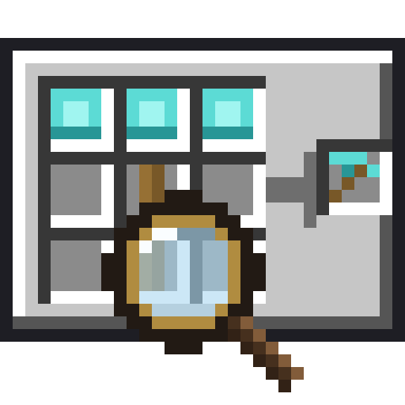
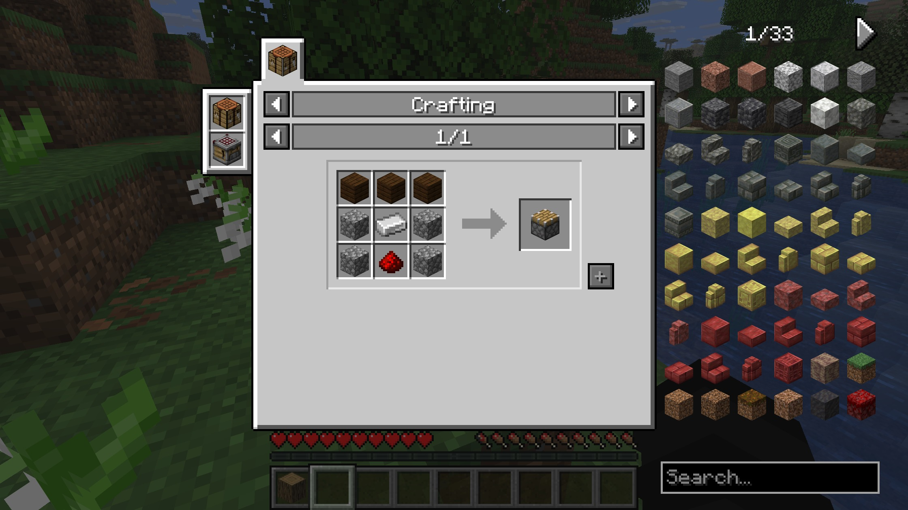
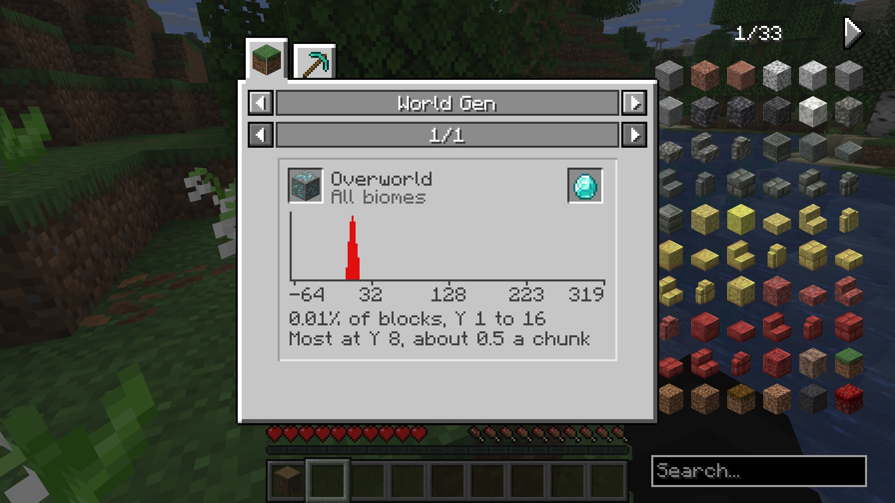
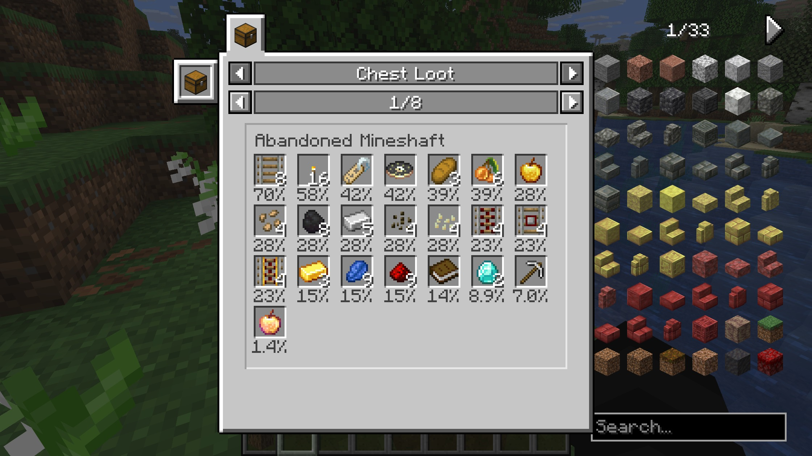
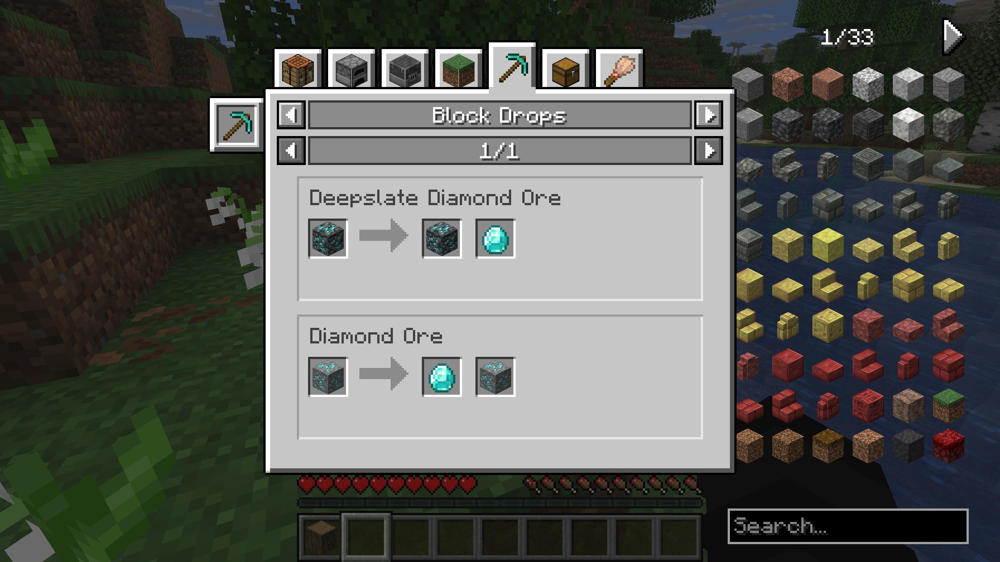
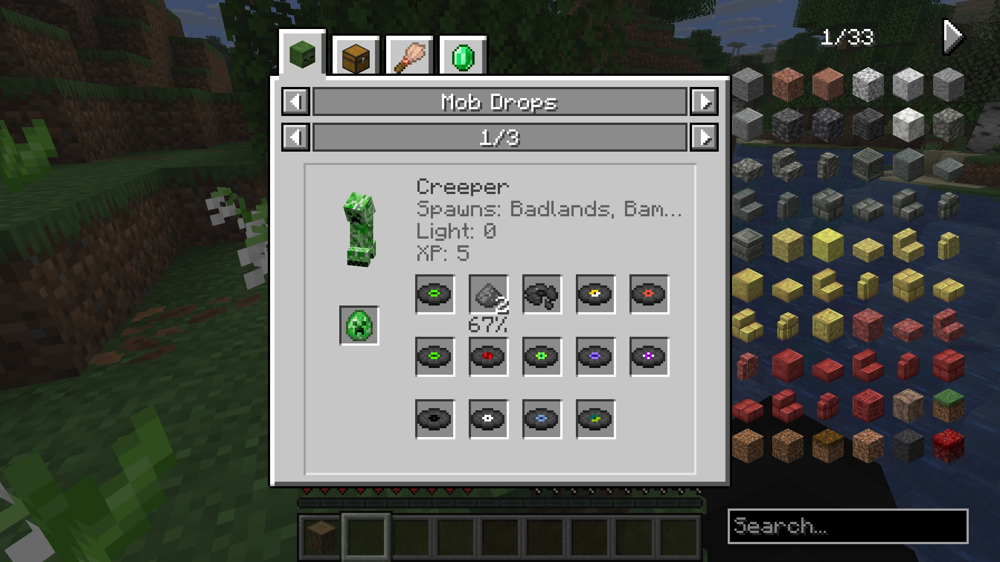
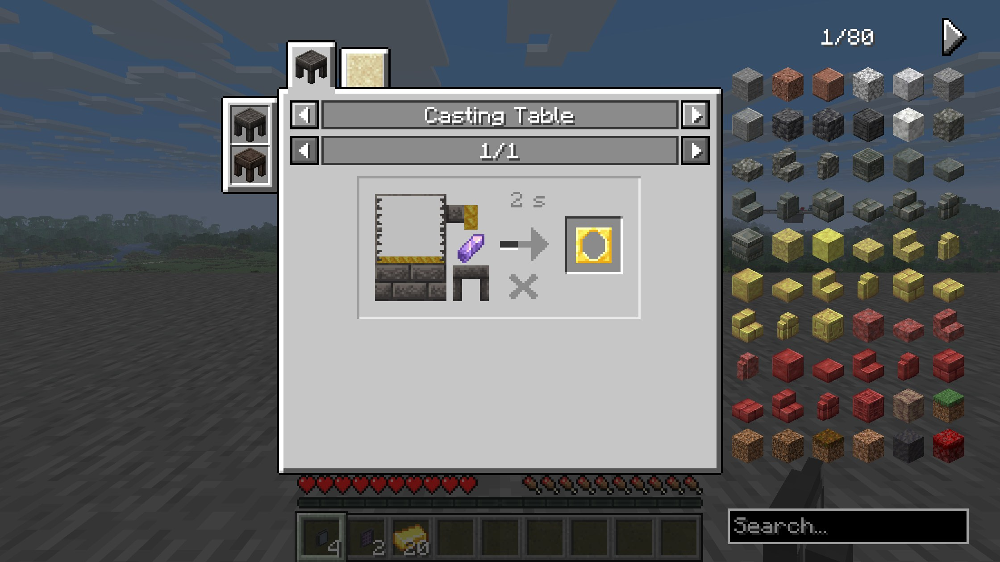
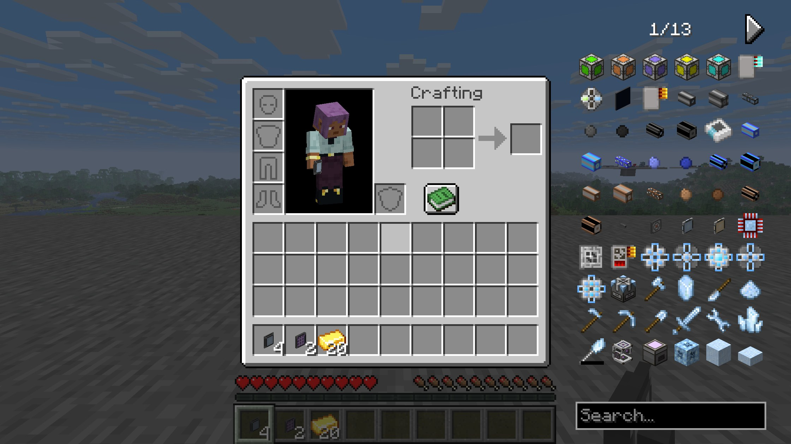
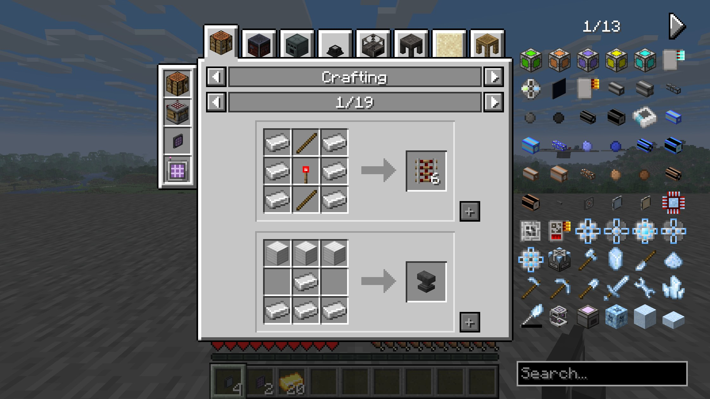

# JEI for Sunrise

<p align="center"></p>

Just Enough Items (mezz, MIT; see `LICENSE`, `NOTICE`) as a native mod on Sunrise's mod API: Hooks only, no mixins,
no `[[inject]]`, no game internals. It is a rewrite on Sunrise's own recipe-viewer APIs, not a copy of the Java mod.

- **Mod id** `jei`, **version** 0.5.2.
- **Game build:** pinned to the Sunrise Nightly of 2026-11-20, game commit
  `94256510f74e6843754e0a93fd9e4da7e45b1056`, Minecraft 26.3. The launcher compiles the
  mod against that build's prebuilt game; a newer Nightly needs a repinned release.
- **Install:** in Sunrise's launcher, Mods › Add from GitHub with this repository, or put the release's
  `jei-0.5.2.smod` in an instance's mods. Native code is not sandboxed: the launcher asks you to trust it.
- **Optional:** `guideme` (the shared guide library), for W over items. JEI works without it.


## Screenshots

| | |
|---|---|
|  |  |
|  |  |
|  |  |
|  |  |

## What Sunrise gives and JEI uses

| JEI part | Fork API |
|---|---|
| Item list beside container screens, its search box, paging | `RecipesClientHost::panel_items` (the game's own panel) |
| Clicks, searches, R/U/A over panel items and screen slots | `Hooks::panel_event` (`PanelEvent::Clicked/Search/Key`) |
| "+" transfer into the open crafting grid or a mod's menu | `transfer_recipe_id(recipe, max)`: the open mod menu's `menu_transfer` part first, then the game's grid |
| "+" red cells for missing items, button state | `transfer_recipe_check(book_id)` (the server's dry run, #2640) |
| Recipes, ingredients, results | `recipes_of_type`, `recipe_ingredient`, `Ingredient::item_keys`, `RecipeRule` |
| Names, tooltips (search, `$tooltip`) | `ItemResource::tooltip`, `TextHost::text_string` |
| `#tag` search | `Host::tags()` |
| R, U, A keys on Options > Controls | `Registrar::register_key_mapping`, read with `mod_key` |
| Creative give (Shift-click) | `ItemsClientHost::give` |
| Fluids drawn as their texture (never a bucket) | `DrawContext::fluid`, `fluid_name` |
| JEI's own artwork (slot, buttons, arrows) | GUI sprites `sunrise/jei/*` the game ships |
| Bookmarks file | `config_files()` (`config/jei/bookmarks.txt`) |
| Other mods' categories | client reload listener over `assets/<ns>/jei/` + the Rust API below |

## What works

- **Item list and search** in the game's panel, JEI's grammar: words (name), `@mod`, `#tag`, `$tooltip`, `&id`,
  `-` negates, `"quoted words"`, `a | b` alternatives.
- **R / U** over a panel item, a screen slot, a bookmark or a slot of the recipe window: its recipes or uses; a left
  click on a panel item shows recipes, a right click uses; Shift-click gives a stack in creative. U on a station
  (crafting table, furnace, a mod's catalyst) shows its whole category first.
- **The recipe window**: a tab per category, category and page arrows, the category's catalysts down the left,
  cards that cycle their ingredients once a second, the game's tooltips with the mod's name, Backspace back, Esc
  closes, scroll turns pages, a click on the title shows the whole category.
  Vanilla categories: crafting (shaped from the file's pattern, shapeless, transmute), smelting, blasting, smoking,
  campfire, stonecutting, smithing (transform, and trim with the trimmed armour as the result), fuel.
- **"+"** on crafting cards: moves one set (Shift: as many as the items allow) into the open crafting grid
  (inventory 2x2, a table, a mod's crafting grid) through the game's viewer transfer (`transfer_recipe_id`); the
  server's dry run greys it and marks missing cells red. A mod's categories get "+" while one of its menus is open
  when the mod says so (`jei::api::register_transfer(menu, category)`, JEI's `addRecipeTransferHandler`); the click
  sends the card's recipe id and the menu's `MenuPart::menu_transfer` on the server moves the items. There is no dry
  run for a mod menu at this Sunrise pin, so that "+" is always lit and a refusal shows when it is clicked.
- **The item list is the creative inventory's** (`ItemsClientHost::creative_tabs`), as JEI's is: items no tab shows
  and the Operator Utilities tab (command and structure blocks, the debug stick, barrier, light) are left out.
- **Potions and enchanted books** are listed one per potion the creative tabs show (potion, splash, lingering, tipped
  arrow; no uncraftable ones) and one per enchantment level, each in the plain item's place, with its own name and
  tooltip for the search. Shift-click gives nothing for them (`give` takes a plain item only).
- **Where things come from**, read from the server's own data files (loot tables, worldgen, structures, villager
  trades), in tabs beside the recipes:
  - **World Gen:** each ore's height graph per dimension, and where other blocks generate.
  - **Block Drops:** blocks that need a tool (silk touch, shears), drop something else, or drop by chance or in
    numbers. A block that simply drops itself has no card.
  - **Mob Drops:** the mob drawn (it follows the pointer), where it spawns (biomes, light, structures, or how the game
    places it: shulkers in End Cities, the elder guardian in Ocean Monuments), its XP and drops with chances.
  - **Chest Loot, Archaeology, Fishing, Piglin Bartering, Shearing:** each table's items with their chance and count
    per stack.
  - **Villager Trades:** each trade under the professions that offer it (26.3's shared `smith` trades go to the
    armorer, toolsmith and weaponsmith), the villager in its profession's clothes, its work station and level name.
  - **Other Sources, How To Get It:** what no table says (concrete hardens from its powder in water, spawn eggs
    are creative only).
- **No empty cards:** a recipe whose items the client doesn't know is left out, and a category nothing fills has no
  tab. A card line too wide for its card ends in "…" and shows whole under the pointer.
- **Tooltips:** an inventory slot's tooltip under the open recipe window is not drawn (it would draw under it).
- **Bookmarks**: A toggles the stack under the pointer; the bar is at the top left (two columns of twelve), left
  click recipes, right click uses, Shift/middle removes, drag to reorder; kept in `config/jei/bookmarks.txt`.
- **W** (GuideME's key) over a panel item or a recipe-window slot opens its guide page when GuideME is installed.
- English and Spanish (`assets/jei/lang`).

## API for other mods

Two ways, both native to Sunrise; use either or both.

### 1. Files: `assets/<namespace>/jei/` (no code, no dependency)

`jei/categories/<name>.json`, one category:

```json
{
  "id": "powah:energizing",                 // default: <namespace>:<file name>
  "title": "jei.powah.energizing",          // translation key or text
  "icon": "powah:energizing_orb",
  "catalysts": ["powah:energizing_orb"],    // U on these opens the category; vanilla ids work too
  "recipe_type": "powah:energizing",        // or a list; read with recipes_of_type (your own type is fine)
  "recipes": [ { ... } ],                   // more recipes, written as recipe files would be
  "size": [130, 50], "arrow": [44, 9], "shapeless": false,
  "background": {"sprite": "powah:gui/jei_energizing", "uv": [0, 0, 130, 50]},
  "slots": [
    {"x": 1, "y": 1, "role": "input", "path": "ingredients", "columns": 3, "step": 18, "max": 6},
    {"x": 100, "y": 10, "role": "output", "path": "result", "chance": "chance"}
  ],
  "fluids": [{"x": 1, "y": 1, "w": 16, "h": 48, "role": "input", "path": "fluid", "capacity": 4000}],
  "texts": [{"x": 1, "y": 40, "text": "jei.powah.energy", "args": ["energy"], "needs": "energy", "color": 4282400832}]
}
```

- `path` picks from each recipe's JSON: `a.b`, `a[0]`, `a[*]`; an array spreads over slots (`columns` per row,
  `step` apart, at most `max`; `"one": true` keeps it in one slot). Inputs are read as ingredients (`"#tag"`,
  `{"item"}`, `{"tag"}`, lists, NeoForge sized `{"ingredient", "count"}`), outputs as stacks (`{"id","count"}`).
- `role`: `input`, `output`, or anything else (shown, neither used nor made). R finds outputs, U inputs and others.
- Fluids are `{"fluid"|"id", "amount"}` in mB, drawn as the fluid's texture filled to `amount/capacity`.
- `texts`: `text` is a translation key with `%s` per `args` path; `needs` skips the line when that path is absent.
  `tr_args` (added 2026-11-13, backward compatible): indexes into `args` whose values are translation keys, translated
  on the client (`"text": "%s %s", "args": ["name_key", "level_key"], "tr_args": [0, 1]`). Vanilla's positional
  `%1$s` / `%2$s` in a translation are filled as well as `%s`.
- A file whose `id` is a vanilla category (`minecraft:smelting`, `minecraft:crafting`, `minecraft:blasting`,
  `minecraft:smoking`, `minecraft:campfire_cooking`, `minecraft:stonecutting`, `minecraft:smithing`,
  `minecraft:fuel`) with only `catalysts` adds stations to it (Iron Furnaces' furnaces to Smelting).

`jei/info/<name>.json`: JEI's Information page: `{"items": ["mod:item", ...], "text": ["key or text", ...]}`.

### 2. Rust: `jei::api` (for recipes worked out at run time)

In `sunrise-mod.toml`: `[dependencies] jei = { version = "^0.4", optional = true }` (nothing in `Cargo.toml`; the
launcher links the crate and turns on the feature `jei` when it is installed). Then, in a client hook (for example
`client_player_logging_in`):

```rust
mod_api::if_installed!(host, jei, {
    jei::api::register_category(jei::api::CategoryDef::new("hostilenetworks:simulation", "jei.hnn.sim", "hostilenetworks:sim_chamber"));
    jei::api::add_catalyst("minecraft:smelting", "ironfurnaces:iron_furnace");
    jei::api::register_recipes("hostilenetworks", my_recipes); // fn(&dyn Host) -> Vec<(String, jei::api::RecipeDef)>
    jei::api::add_info(&["hostilenetworks:prediction"], &["jei.hnn.info.prediction"]);
});
```

`RecipeDef::new(id, [w, h]).input(x, y, &[("mod:item", n)]).output(..).other(..).chance(p).fluid(rect, role,
fluid, mb, capacity).text(x, y, key).text_tr(x, y, key, &[args]).arrow(x, y).shapeless().background(sprite, uv).hover([x, y, w, h], &[lines]).sprite(sprite, uv, x, y)`
(`sprite`, added 2026-11-14: a GUI sprite's part drawn at its own size over the slots and under the texts; `hover`: a tooltip of the card's own over that area, lines as translation keys or text, `§` codes allowed). `register_recipes` is asked
again on every index build (joining a world, a resource reload, the server's recipes arriving).
`text_tr` (added 2026-11-13; `text` unchanged): `key` with `%s` per argument, each argument literal or, written with
`jei::api::tr_arg(key)`, translated on the client (Ender IO's enchanter: `text_tr(x, y, "%s %s",
&[&tr_arg("enchantment.enderio.repellent"), &tr_arg("enchantment.level.1")])` shows "Repellent I").
`jei::api::show(item, uses)` opens the window on an item from your own code.
`jei::api::register_transfer(menu, category)` (added 2026-11-16, 0.3.1): "+" on `category`'s cards while a screen of
mod menu type `menu` is open; the server's `MenuPart::menu_transfer` for that menu gets the card's id as `recipe`.
Added 2026-11-14 (all optional; cards that don't call them look as before), for cards drawn as Java's on a
background of their own (Tinkers' casting, molding, melting):
- `.frameless()`: no slot frames (the background has its own, or Java draws none);
- `.fluid_bare(Some((sprite, uv)))` after a `.fluid(..)`: that fluid without the frame and grey fill, with the
  sprite part (a tank's gauge) stretched over it; `None` for no gauge (a faucet's stream). Fluids are now tiled
  edge to edge in any rect (a 6-wide stream, a 4-high level), not 16-wide squares with gaps;
- `.sprite_under(sprite, uv, x, y)`: as `sprite`, under the slots;
- `.icon(item, x, y)`: an item's icon with no slot frame and no focus;
- `.animated(sprite, uv, x, y, period_ms)`: JEI's `buildAnimated(.., LEFT, false)` arrow, revealed left to right;
- `.text_centered(x, y, text, argb)`: a line centred on x (as `text_tr`'s keys and arguments).
The window is now as tall as its fullest page (at most 260), and the dimming stops at the container's right edge so
the item panel and its tooltips stay lit. The search is answered while the game dispatches it: a query that matches
nothing (or a bare `@`, `#`, `$`, `&`, `-` while typing, which now match everything) no longer takes the panel and
its search box away.

**Subtypes** (JEI's `ISubtypeInterpreter`; added 2026-11-13, backward compatible): `jei::api::register_subtype(item,
component)` tells stacks of `item` apart by the value of their data component `component`. A slot names such a stack
by appending its components to the id in the game's JSON form, for example
`"hostilenetworks:prediction{\"hostilenetworks:data_model\":\"hostilenetworks:zombie\"}"`; the card then draws
that stack (its tint, its name) and its tooltip is that stack's. R and U on a stack of a registered item (a screen's
slot, the creative screen's, a card's) find only the cards whose slot holds the same component value; a slot naming
the bare id still matches every subtype, and items with no subtype registered behave exactly as before. Hostile
Neural Networks uses it so U on a zombie Prediction lists only the zombie's Loot Fabricator recipes. A screen's slot reports its components in vanilla's item syntax (`[ns:name="value",...]`), which
`component_value` reads as well as JSON. The creative screen sends no panel events, so JEI reads R/U there itself: the
slot's stack through the menu's slot boxes, else the hovered item, with the subtype the player's inventory has of it
when that is unambiguous.

`tests/demo` is a mod that uses both (a `jeidemo:crushing` category from files with fluids, chances and energy text,
a smelting catalyst, an information page, and a composting category from Rust).

## Tested in game (2026-11-12, `tests/ingame.sh`, offscreen, screenshots in `Z:\AE2Converter-build\fork-game-jei\shots`)

These results are from the arismoko/horizon fork, before the move to Sunrise. On Sunrise the mod compiles against
the pinned Nightly's prebuilt game; it has not been played through again there yet.

Panel beside the inventory with paging; click on a panel item (Stone: Smelting card with XP, time, fuel cycling,
catalysts furnace + the demo's lava bucket); U over a screen slot (planks: tabs per category, tag ingredients
cycling); R over a slot (crafting table, 2x2 card); "+" (server check says Moves; the click put 4 planks in the
inventory grid, result shown); A bookmark (bar top left, saved); `/jei search #planks -oak`; the demo's file
category (Crushing: fluid well, 10% chance, "2000 FE"), its data recipe type and inline recipe; the Information
page; the Rust API category (Composting, first for U on its catalyst); `/jei debug`. Not driven by the test: typing
in the search box (ctl sends key events, not characters; `/jei search` runs the same filter) and the red "missing"
cells (shown from the server's `Missing` answer).

## Workarounds kept, and why (Sunrise API gaps)

- **The recipe window is drawn by JEI** over the screen. Sunrise's own recipe page (`Game::native_panel_recipes`:
  the game's slots, tabs, fluid wells and chances in the panel's place) is not in the mod API
  (`029-host-helpers-and-remaining-gaps.md` lists `panel_recipes` as not in the trait). When it is, the window
  should move there.
- **Recipe-book display ids for "+" are worked out by JEI.** `transfer_recipe` takes vanilla's display id, which
  the API doesn't give by recipe. The server learns the recipe types from its `recipe/` files (a server reload
  listener), numbers every recipe as `RecipeManager.unpackRecipeInfo` does (registration order, path then
  namespace; transmute recipes one per material count; special, decorated-pot and brewing none) and sends the
  crafting recipes' ids on `jei:displays` at login and when the client asks (in parts: a mod message holds at most
  30000 bytes). A data pack that changes recipes after login needs a relog for "+" to follow.
- **"+" into a mod's menu has no dry run** at the pinned Sunrise (`transfer_recipe_check` takes a recipe-book id;
  a later Sunrise takes the recipe's id): it isn't greyed or marked before the click. Crafting cards still find their
  display id through the table above for the check.
- **Mob Drops, World Gen** (the upstream kit's Just Enough Resources pages) are not here: loot tables and world
  generation are server data the client can't read, and there is no API to list them for a client.
- **Other subtypes** in the creative tabs (goat horns, ominous bottles, firework rockets, paintings) are listed
  once; only potions and enchanted books are split (`creative_search_items` would give them all).
- **The mouse wheel pages the item panel** by Sunrise itself (sunrise#1425): the panel is the game's, and the
  game turns its page under the pointer. The internals injection that did this on the old fork (`wheel.rs`, at the head
  of `Game::tick`) is gone; JEI's own window still scrolls with the wheel (`screen_mouse_scrolled_pre`).
- **The creative screen**: the panel is the game's, shown where the game shows it.
